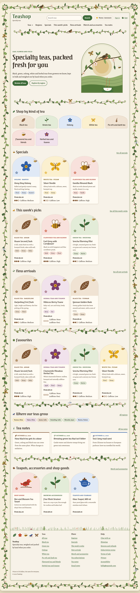

# Teashop

The software for a small online specialty tea business: a storefront,
inventory, order fulfillment, reports for the books and taxes, a
marketing email list, and AI agents for customer support, marketing and
server upkeep, built on Django to run on one leased server.



## How it was built

Teashop is a test of the autonomous development features in Wing Pro
12.1, a Python IDE from [Wingware](https://wingware.com/).  AI agents
(Claude Code) wrote all of it, starting from one prompt, with Wing's
Tasks Manager queueing and running the work.

The Tasks Manager is itself an AI agent, working inside the IDE.  You
give it a request; it turns it into a queue of tasks, hands each task to
a separate coding agent, answers the agents' questions or passes them to
you, checks their work, commits it, and starts the next task.  The
agents file the problems they find along the way as new tasks, and
record the judgement calls they make, so you can review them.  Here it
planned the business, split the plan into phases, and ran up to four
tasks at a time.

The run took about six and a half hours, on November 1, 2026, from
5:19 pm to 11:43 pm.  53 tasks ran and made 37 commits.  Another 30
tasks that the agents and the Tasks Manager filed along the way were left
for later: going live (creating the hosting and payment accounts and
setting up the server), live trials of the AI agents, and smaller
features.  So nothing here has been deployed or tried against real
payment, shipping or AI accounts: those parts run against stand-ins.

The user wrote a description of the business in
[teashop.txt](teashop.txt), and started the run with this prompt:

> See the file teashop.txt for a description of the project I want to start.

<details>
<summary>teashop.txt, the description of the business</summary>

> I am starting an online tea business which will sell specialty teas through its
> own custom website.  I plan to run this out of my house and don't have a lot
> of startup capital so I want to try to develop all the necessary software myself.
> I'm thinking I need a website hosted on a fractional server I lease and run myself,
> and this can run the various components in a way that allow me to access what I
> need during purchasing, order fulfillment, etc either from my laptop or phone.
>
> The capabilities needed are:
>
> (1) An inventory system which can track raw materials (tea, packaging, etc).
> Packaging would be tracked by unit. Teas need to be tracked by weight. The
> system needs keep track of reducing stock as orders come into the store (see (2)
> below), notify me for teas getting low, help with ordering replacement supplies
> and tea, and help me track waste or missing inventory over time, and also cost
> of purchases and revenues made from teas or other items sold so I can see how
> well or poorly each does.
>
> (2) A public store website. The site needs to look nice, reflecting natural
> design motifs like leaves, flowers, birds, and pollinator insects, in attractive
> browns, greens, and some primary colors mixed in.  We'll want a site that can be
> either light or dark background and tries to adapt to the user's system if possible.
> It definitely needs to be a visually pleasing site that people will want to stay
> on and look around.  I think with AI agents designing pages, possibly making
> variants for each tea or tea type, this can be beautiful and also varied within
> a common theme.  Of course it cannot reuse any existing branding or trademarks
> and has to be unique in design.
>
> The site will split into sections by tea type such as black, oolong, green,
> flavored, etc, and also be geographic region and other sortings that would be
> useful for customers, such as specials, this week's recommendations, and other
> such things. Teas will be available in different sized packages, some just in
> paper and others in tins. The available sizes will vary by tea depending on its
> unit price (smaller packages if more expensive), and will be set in the
> inventory system.
>
> There should also be a section for branded merch and accessories (tea making
> supplies, tea pots, etc).  I'm not yet sure what we'll have in those and likely
> will be minimal to start with, but these also need to be tracked in the inventory
> system.
>
> Finally I think a section with tea information, history, etc would be useful.
> We'ld build that up over time using content we develop for marketing (see
> below).
>
> The site needs to have an online cart and checkout process that's streamlined
> and easy to use, accepting as many payment types as possible and accurately
> computing shipping using USPS (because they will pick things up at my home for
> free). I don't know how to set that up and need suggestions for the best system
> to use. I'll be shipping only within the contiguous 48 states initially, and not
> internationally.
>
> (3) Once orders are placed, I need a backend system that notifies me and gives
> me a dashboard for order fulfillment, including ability to purchase and print
> shipping labels. Ideally it will just know the package size/weight based on what
> was ordered, or I can tell it which box size was used first if needed.
> Presumably we also need to keep track of available shipping boxes in the
> inventory and any packaging material and try to also have accurate inventory of
> those so I know when to reorder.
>
> (4) For running the business, I need to be able to get reports for sales in
> different periods, accurate automatic accounting, and all the data I'll need for
> taxes. Initially I won't have staff but will need to pay myself and do the
> payroll taxes somehow. It would grow a fuller payroll system in the future if I
> can hire people later.
>
> (5) Since the software will be extended over time, I need a simple way to deploy
> updates to the leased server, and automatic or semi-automatic OS updates on the
> server to keep it secure. Security in the self-developed software itself will
> also be important, so the development and maintenance process should include
> regular security reviews. Some of this could be run by an AI agent that can log
> into the server and manage it. I don't have the expertise to do this myself and
> likely won't have money to hire anyone.
>
> (6) I need support for setting up and managing marketing on social media and
> elsewhere that makes sense.  This could also be run by an AI agent that has
> access to the business social media accounts so it can post about new teas,
> tea making tips, tea related history, or other interesting things.  What to
> post would be a combination of my own ideas and the agent's.  When and where
> and exactly what to post (or not) would be something I approve and control.
> If not hopelessly obsolete as an idea, I'd also like to be able to set up
> a marketing email list where we can also send postings.  That should be opt-in
> only (default=no) and done in a way that does not overwhelm recipients.  We
> might even allow them to say up front how often they want an email at most.
>
> General principles: I want the business to run itself as much as possible. I
> want to be involved in any public-facing decision and for anything that costs
> money, so I'm still the approver of many actions taken, but otherwise as much as
> possible the business should just work on its own, similarly to how I described
> using AI agents in (5) and (6) but possibly extending to other things where it
> makes sense to automate. One idea for that is to do customer support which I'm
> envisioning by chat and email. The design for that would be that the agent can
> answer if there's no doubt or judgement call to be made, and otherwise consult
> me first. I would want to train it to respond in my own voice and style, where
> possible, so it might initially watch and later take over. I'm thinking the
> website might have sort of a top-level owner dashboard where I can see things
> that need my attention, and I'd get emails when I don't respond within set time
> periods which vary depending on what it is that is waiting for me. I (or some
> human) will of course need to be the one that unpacks and shelves ordered
> supplies and product and the person that packs up orders and sends them out.
>
> I am not sure if I'm forgetting important aspects of this.  I do still need
> to come up with a name for the company and purchase the appropriate domain
> name(s), and I'm sure there are many decisions to make such as which hosting
> provider, the actual site design, and much more.
>
> This is a large from-scratch project, a complete mostly automated company and
> all the software behind it. Ask me about any details I've forgotten, as needed.
> Let's start by assessing the above for feasibility and estimating about how much
> time would be involved in developing and setting this all up. I think that's the
> first step, probably in context of a somewhat fleshed out version of what I
> wrote above.  Then we'll go from there.
>
> I hope to keep a record of the development of this software as it goes through
> the different stages, so please keep screenshots of milestones in doc/shots.

</details>

The first task assessed it and reported back a fuller set of
requirements, its feasibility, what to build and what to buy, a rough
schedule in phases, and open questions.  The user answered the
questions, then asked:

> Next I would like to investigate all the legal, regulatory, tax, etc,
> issues that affect the business to see if it's feasible from that
> standpoint.

The user answered the legal review's questions in turn, and had the
Tasks Manager file the plan's eleven phases as tasks, which it then ran.
Late in the run, the user made two more requests:

> I don't see where in the dashboard to set up inventory, shipping
> supplies, etc.  Does this exist already?  Either way, can you populate
> the local dev database with some sample teas and other content?

> The graphic design of the site is a bit weak.  I was envisioning much
> richer natural look, with vines and branches and leaves twining around
> the edges and between page areas.  The leaves. birds, insects, etc,
> would be in those vine/branch/leaf areas.  The overall look inspired by
> elven art, art nouveau, and jugendstil era German children's books.
> Can you work up a mockup for me to react to, opening it in my browser
> when done?

From the mockup ([doc/mockups/vine-style.html](doc/mockups/vine-style.html)),
the user picked the "Spring moss" palette and medium ornament, and a
further task applied the style to the customer pages.

The screenshots in [doc/shots/](doc/shots/) record how the site looked at
each milestone.  [run-trail/RUN.md](run-trail/RUN.md) is the run's full
trail: every task with its prompt, the questions and who answered them,
the judgement calls, the findings filed, the commits and screenshots, and
the time and tokens each used, followed by what went wrong along the
way.  Its [use of Wing's MCP tools](run-trail/RUN.md#use-of-wings-mcp-tools)
section counts the calls the agents made to the IDE features Wing gives
them as MCP tools, by server and tool, and how often they used their own
tools instead for the same jobs.  [run-trail/trail.json](run-trail/trail.json)
has the same data.

## What was built

The plan's eleven phases, each a Django app or two under `apps/`:

1. **Foundation:** the Django project, the owner's two-factor login, an
   append-only audit log of admin, agent and system actions, Docker,
   deployment from git with a backup before each deploy and a rollback,
   server hardening scripts, encrypted off-site backups with a restore
   test, and a security policy and breach-response checklist.
2. **Catalog and inventory:** teas tracked by weight in lots and
   packaging by the unit, with each package size using up its tea, tin
   or pouch and label; low-stock and best-by alerts.
3. **Storefront:** the public shop, by kind of tea, region and
   collection (specials, this week's picks, new arrivals), with merch and
   accessories, tea notes, light and dark themes that follow the
   visitor's system, and every page checked against WCAG 2.2 AA.
4. **Cart and checkout:** Stripe-hosted payment, USPS rates through
   EasyPost, sales tax, customer accounts and tea subscriptions.
5. **Fulfillment:** the packing queue, box suggestions from the
   packages' sizes, labels and postage, USPS pickups and refunds.
6. **Owner dashboard and reports:** a "Needs your attention" list with
   reminder emails when things wait too long, sales, margin, sales-tax
   and estimated-tax reports, and daily summaries for the accounting
   service.
7. **Purchasing and losses:** stock counts, purchase orders drafted from
   reorder levels, and loss and profit reports.
8. **Marketing email list:** opt-in with confirmation, consent records,
   a per-subscriber limit on how often they get mail, and mailings the
   owner approves.
9. **Customer support agent:** chat and email support that answers alone
   only when there is no judgement call, and otherwise drafts a reply for
   the owner, with a watch mode for learning the owner's voice.
10. **Marketing agent:** drafts posts, articles and list emails from an
    idea backlog, onto a calendar the owner approves.
11. **Ops and security agent:** hourly server health checks, daily upkeep
    through a limited server account, and the quarterly security review.

The AI agents share a spending cap, label what they write as from an AI
assistant, and run on an offline stand-in until given an API key.  There
are over 800 tests, including browser tests of every page.

## Run it on your computer

Needs Python 3.13 or newer.

```sh
python3 -m venv .venv
.venv/bin/pip install -r requirements.txt
.venv/bin/python manage.py migrate
.venv/bin/python manage.py createsuperuser
.venv/bin/python manage.py runserver
```

In Wing, the Debug button runs the development server (the main entry
point, `manage.py runserver`); the named entry point "Migrate dev
database" applies migrations first.

To fill the development database with a made-up shop (teas, suppliers,
stock, orders at several stages, a subscription, email subscribers,
support and marketing content), run, as often as you like:

```sh
.venv/bin/python manage.py load_demo_shop
```

It refuses to run unless `DEBUG` is on.

Open http://127.0.0.1:8000/ for the shop and
http://127.0.0.1:8000/account/login/ to sign in.  The first sign-in takes
you to two-factor setup: scan the QR code with an authenticator app
(Google Authenticator, Authy, 1Password, ...), and save the backup codes.
After that, the owner dashboard is at /owner/ and the back office (Django
admin) at /admin/.

Development uses SQLite in `var/`; set `DATABASE_URL` to use PostgreSQL.

Run the tests with Wing's Testing tool or `python manage.py test apps`.

The browser tests (tagged `ui`) open each page in headless Chromium at
phone and desktop widths, in the light and dark themes, check it against
WCAG 2.2 AA with axe-core, and save screenshots to `var/shots/`.  They
need, once:

```sh
.venv/bin/pip install --require-hashes -r requirements-ui.lock
.venv/bin/playwright install chromium
```

Without them those tests are skipped.  `--exclude-tag ui` leaves them
out; `python manage.py milestone_shots <name>` records a milestone's
screenshots in `doc/shots/` (see `doc/shots/README.md`).

## Run the whole stack locally (as on the server)

Needs Docker.  Copy `.env.example` to `.env` and set, for a local trial:

```
SITE_DOMAIN=localhost
HTTP_PORT=8080
HTTPS_PORT=8443
CSRF_TRUSTED_ORIGINS=https://localhost:8443
```

plus random values for `DJANGO_SECRET_KEY`, `POSTGRES_PASSWORD` and
`RESTIC_PASSWORD`.  Then commit your work and run `deploy/deploy.sh`.  The
site is at https://localhost:8443/ (your browser will warn about Caddy's
local certificate).

## Where things are

| Path | What |
|---|---|
| `config/` | Django settings (all from environment variables) and URLs |
| `apps/` | One Django app per feature; see `docs/architecture.md` |
| `apps/core/` | Health check, owner dashboard, shared helpers |
| `apps/storefront/` | The public shop; see `docs/storefront.md` |
| `apps/audit/` | Append-only log of admin, agent and system actions |
| `apps/*/` | The other features, each with its own page in `docs/` |
| `templates/`, `static/` | Site-wide templates and styles |
| `compose.yaml`, `Dockerfile` | The server stack: PostgreSQL, the app, Caddy, backups |
| `deploy/` | Deploy, rollback, backup and server setup scripts |
| `.github/workflows/` | CI on every push; deploy on push to `release` |
| `docs/ops/` | Running the server: setup, deploys, backups, monitoring |
| `docs/security/` | Security policy (NY SHIELD Act) and breach response checklist |
| `doc/shots/` | Screenshots of each milestone |
| `doc/mockups/` | The vine-and-leaf design mockup |
| `run-trail/` | The record of how Teashop was built (see [How it was built](#how-it-was-built)) |

## License

MIT; see [LICENSE](LICENSE).  The Federant and Alegreya fonts in
`static/fonts/` are under the SIL Open Font License.
